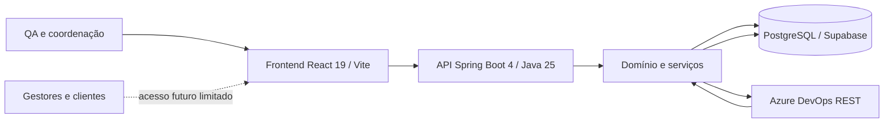
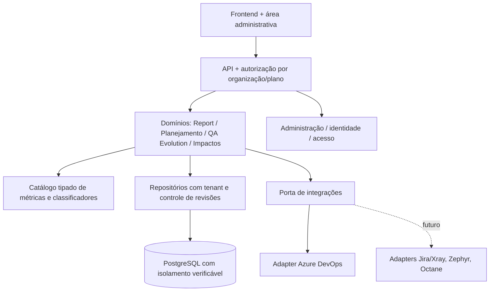

# FourQA — Arquitetura do produto

> **Referência arquitetural | atualizado 04/11/2026 | base v1.0 (auditoria ZIP) + working tree.**
> **Leitura rápida:** o FourQA é hoje uma aplicação web com frontend React/Vite, **API Java 25 / Spring Boot 4** (`backend/`, host separado; a Vercel faz rewrite de `/api/*`) e banco PostgreSQL. Recebe resultados do Azure DevOps, calcula indicadores e mantém o planejamento no próprio FourQA. Express/TypeScript, ASP.NET e Python/FastAPI são **históricos** (`DEC-032`, `DEC-041`). O host Java ainda não foi homologado. Capacidades multiempresa e perfis de acesso são **objetivo**, não infraestrutura já pronta.

## 1. Como utilizar este documento

**Para quem não é técnico:** leia as seções 2, 3, 4 e 11. **Para engenharia:** consulte também os contratos, rastreabilidade por arquivo, modelo de dados, limites de segurança, decisões e plano de evolução. **Fontes de verdade:** código e testes do ZIP > ADRs em `.cursor/docs/adr/` > `REQUIREMENTS.md` (v1.2) > `VISION.md`. Pesquisa original serve apenas como referência histórica e contém hipóteses não verificadas. Consulte `DECISIONS.md` para distinguir decisões aprovadas de propostas.

**Classificação das afirmações:** `[VERIFICADO]` = presente no código/documento do ZIP; `[DECIDIDO]` = requisito ou regra aprovada nas conversas, ainda que não implementada; `[PROPOSTO]` = alternativa técnica a validar; `[ABERTO]` = bloqueio ou escolha pendente. A auditoria é **estática**: não foram executados testes, acesso ao Azure, consultas ao banco remoto ou deploy nesta elaboração.

## 2. Contexto e limites

**O que o cliente recebe:** um painel que apresenta status, realizado, planejamento, execuções e falhas sem alimentar uma segunda planilha. **Onde o trabalho é executado hoje:** Azure DevOps. **Quem decide metas e responsabilidade de suíte:** FourQA. O FourQA ainda não cria Test Cases, runs nem bugs no Azure; consulta os resultados.

**Fronteiras:** a UI apresenta números e captura ações de planejamento; a API valida e autoriza; o domínio é dono das fórmulas; o Azure é fonte de resultados; o PostgreSQL é dono de snapshots e metas FourQA. O plano externo tem IDs próprios. **Não equiparar `plan_key` a uma organização ou a um Test Plan persistido multiempresa.**

## 3. Inventário da implementação atual `[VERIFICADO]`

| Peça | Evidência no repositório | Comportamento identificado |
|---|---|---|
| Tooling / UI | `package.json` | npm workspace `frontend` (Node 22); scripts raiz `test`, `typecheck`, `build`, `dev` orquestram API Java (Maven Wrapper via `scripts/mvnw.mjs`) + SPA. |
| Frontend | `frontend/src/App.tsx`, `frontend/src/api.ts`, `frontend/src/pages/` | React 19 / Vite / React Router. Rotas `/`, `/planejamento`, `/status-frente`, `/execucoes`, `/falhas`. |
| Backend | `backend/pom.xml`, `backend/src/main/java/com/fourqa/api/web/ApiController.java`, `IdentityController.java` | Spring Boot 4, Java 25 e endpoints `/api/*`. |
| Entrada Vercel | `vercel.json` | SPA servida de `frontend/dist`; rewrite externo `/api/:path*` para o host Java (destino `fourqa-api.invalid` até a homologação). |
| Domínio | `backend/src/main/java/com/fourqa/api/domain/` (`Formulas`, `Dimensions`, …) | Cálculos, status, hierarquia e identidade de planejamento. |
| Serviços | `com.fourqa.api.services` (`ReportService`, `PlanningService`, `SyncService`, `SyncJob`) | Agregação de Report, planejamento, sync e status de job. |
| Persistência | `com.fourqa.api.persistence` (`Database`, `Jdbc*Store`, `Migrations`) | Stores por contrato; PostgreSQL operacional, SQLite para testes/legado. |
| Conector | `com.fourqa.api.connector` (`TestDataSource`, `TestDataSources`) | Porta mínima da fonte de dados de teste usada por `SyncService.runSync` (DEC-043, ADR 009 E1). Padrão: Azure; fábrica trocável só em testes. Único adapter: `azure.AzureTestDataSource`. ADR 009 segue proposto. |
| Azure | `com.fourqa.api.azure` | Somente Azure DevOps, leitura de suites/pontos/results/bugs via REST com PAT. |
| Testes | `backend/src/test/java/` | JUnit 5 + MockMvc via `./mvnw verify` (`npm test`), golden HTTP herdado do Python; frontend smoke em `frontend/test/`. |
| Stacks legadas | — | Express/TS, ASP.NET (`DEC-032`) e Python/FastAPI (`DEC-041`) **ausentes** do working tree. |
| Segurança transitória | `com.fourqa.api.auth.WriteAuth`, `frontend/src/api.ts` | Bearer compartilhado; browser guarda cookie HttpOnly `fourqa_session`; Vercel Authentication é proteção de hospedagem. |

### 3.1 Contratos HTTP existentes

| Método e rota | Finalidade | Proteção de escrita / observação |
|---|---|---|
| GET `/api/health` | Saúde mínima do banco | Não inclui dados de negócio. |
| GET `/api/home`, `/api/meta` | Report e período | GET protegidos no Preview conforme configuração. |
| PUT `/api/cabecalho`, `/api/periodo` | Alterar título/subtítulo e período | Exigem bearer; a alteração do período pode mudar cálculos. |
| GET `/api/planejamento` | Planejamento e revisões | Usa `planKey` da consulta ou fallback. |
| POST `/api/planejamento/revisao` | Confirmar/revisar baseline | Exige bearer. |
| PUT `/api/planejamento/celula` | Editar datas, quantidade, responsável e prioridade | Exige bearer. |
| GET `/api/status-frente` | Status agregado de frentes | Somente leitura. |
| GET `/api/execucoes`, `/api/falhas` | Snapshots paginados e busca | Somente leitura. |
| POST `/api/sync`, GET `/api/sync/status` | Disparar sync/acompanhar job | Disparo exige bearer; GET respeita proteção do ambiente. |

**Não estão no código:** `/api/users`, `/api/testplans` multi-conector, gestão de KPI configurável, OAuth/SSO, divisão de metas por QA, histórico de célula, link público revogável, integrações Jira/Xray/Zephyr/Octane.

### 3.2 Fluxo da informação

1. `backend/src/azure/config.ts` lê parâmetros de organização, projeto, PAT, planos e mapeamentos por ambiente. Esses parâmetros **não** constituem uma configuração administrável por usuário.
2. `backend/src/services/syncService.ts` inicia a sincronização; `azure/client.ts` faz chamadas HTTP, retentativas e paginação pelos coletores; `execucoes.ts` lê Test Points e resultados atuais; `falhas.ts` relaciona bugs aos resultados.
3. O snapshot operativo persiste em `execucoes` e `falhas` com metadados do refresh. Na Vercel, o trabalho é assíncrono via `waitUntil` e o progresso fica no metadado `sync_job`. `postgresAzureSnapshotStore.ts` substitui o lote, preservando planejamento.
4. `ReportService` calcula os KPIs e `PlanningService` calcula as visões do planejamento. Os cálculos de Home e Planejamento coexistem por decisão de legado — **não uniformizar sem revisar o ADR 003**.
5. O frontend recebe DTOs e renderiza; não deve criar fórmulas de negócio paralelas.

**Limite importante:** `execucoes` representa o estado corrente por Test Point, não o histórico completo de movimentações. Um refresh não basta para reconstruir retrospectivamente quem fez cada transição ou a produção por dia/por QA. `run_by` existe em registros, mas não define o proprietário FourQA da meta.

## 4. Modelo de dados atual `[VERIFICADO]`

Migrações versionadas só em `backend/src/main/resources/db/postgres/` (`001_baseline.sql` a `006_connection_invite.sql`), aplicadas por `persistence.Migrations`. 

| Entidade/tabela | Explicação para negócio | Relação técnica e limite |
|---|---|---|
| `workbook_meta` | Metadados do projeto, período, refresh | Chave/valor e estado de sync; não é configuração multi-tenant. |
| `planejamento_linhas` | Dados migrados da planilha | Legado; datas, QA, quantidades e cancelados. |
| `execucoes` | Situação atual dos cenários no Azure | Uma linha por ponto do snapshot, identificadores de plano/suíte/ponto/caso. |
| `falhas` | Bugs identificados nos resultados | `bug_id`, atributos, classificação, vínculo com plano. |
| `planning` | Plano de planejamento FourQA | Identificado por `plan_key` (texto único). |
| `planning_revision` | Versões de baseline | Versão, motivo e origem do escopo, sem autor por célula. |
| `planning_scope_item` | Quais cenários pertencem ao baseline | IDs de Test Point e Test Case; não corresponde a alocação nominal por QA. |
| `planning_item` | Linha planejada por suíte/ponto | `baseline_quantity`, `responsavel` texto, `prioridade` texto; não vários QAs. |
| `planning_allocation` | Quantidade planejada por data | Identidade `(item_id, alloc_date)`; não inclui `user_id` ou Test Case atribuído. |
| `planning_change_log` | Trilha da célula após a migração 004 | Tabela nova e vazia. Sem backfill. Liga-se a `planning` pelo `plan_key`. |
| `schema_migrations` | Controle de migrações | O código aceita o prefixo 1–3 ou 1–4. O boot não aplica script. |

**Não existem** tabelas nativas `organization`, `user`, `testplan` multi-fonte, `kpi_definition`, `category_mapping`, `planning_qa_allocation` ou `audit_event`. Nomes aqui são **conceitos candidatos**, não nomes aprovados de migração.

### Janela PostgreSQL 3 → 4

O código publicado que só conhece as versões 1–3 recusa a versão 4. O código desta janela sobe com `[1,2,3]` ou `[1,2,3,4]`. No schema 3 a célula grava e o histórico espera a tabela. No schema 4, célula e histórico vão na mesma transação: falha no histórico desfaz a célula.

Aplicar a 004 no Supabase só depois de backup e de este código estar no ar. Sequência: backup do projeto; `db:postgres:preflight` e parar se houver falha além de `planning_change_log` ausente com pending `[4]`; `db:postgres:migrate`; `db:postgres:verify` com versions `[1,2,3,4]`; editar uma célula e ler o histórico do mesmo `plan_key`.

`DROP TABLE` não é recuperação. A transação da migração já desfaz uma 004 que falha antes do commit. Depois do commit, a recuperação suportada é restaurar o backup. Um `DROP` apagaria a trilha já gravada e não devolveria o ledger nem o código anterior.

## 5. Regras críticas e compatibilidade

- **Classificação:** `classifyExecution` é a regra de sete estados; a soma das sete colunas é igual aos Test Points do escopo; ADR 002. Passed com Test Case não Closed não deixa de ser Passed.
- **Report atual (ZIP):** o painel apresenta Total, Planejados, Finalizados, Pendentes e sete status. `Finalizados = Passed + N/A`, `Pendentes = Total − Finalizados`. O componente `ScenarioStatusPanel.tsx` já inclui ícones para Passed, N/A e Pendentes. **Isso não significa que todos os rótulos do Report foram modernizados.**
- **Exceção de legado:** Status por Frente e Planejamento ainda podem incluir `cts_cancelados` em finalizados; Report mudou essa regra deliberadamente. Esta divergência deve aparecer em testes e explicações ao cliente, não ser eliminada silenciosamente.
- **Baseline:** ao confirmar, o escopo é congelado; mudança posterior no Azure exige nova revisão com controle de escopo (ADR 004).
- **Feriados/finais de semana:** a grade mostra o fim de semana bloqueado. Um dia abre na sessão, ou porque já tem quantidade. Desativar com quantidade zera só aquele dia, numa transação, e não redistribui. Reativar não restaura quantidade. A disponibilidade sem quantidade não sobrevive ao recarregar: não há coluna nem tabela para isso. Persistir exige schema novo e não entra na migração 004. `workbook_meta` não é escopo de plano.
- **Responsabilidade:** hoje uma string por suíte; o futuro compartilhamento é quantidade por QA, preserva QA principal e não escolhe Test Cases.
- **Evolução QA:** requerida automática e individual. Se 30 execuções forem observadas na suíte com metas João20 e Cláudia10, a divisão quantitativa sozinha **não prova** quem executou 20 e 10. É uma lacuna de rastreabilidade, não uma fórmula pendente de código.
- **Ofensor versus ambiente:** onde o bug ocorreu (`ambiente`) não define quem é responsável pelo impacto (`categoria/ofensor`).
- **Unidades:** um Test Point impactado não equivale a um bug. Um bug pode afetar mais de um ponto.

## 6. Arquitetura-alvo: proposta modular, incremental `[PROPOSTO]`

**Diretriz:** evoluir a **API Java/Spring Boot** (ADR 008) e o frontend React já existentes; **não** reintroduzir Express/Node, ASP.NET ou Python como API, nem migrar para microserviços sem motivo mensurável. Interfaces compartilhadas entre backend/frontend devem ser introduzidas quando reduzirem divergência real; contratos de API externos exigem validação em runtime. Encapsular conectores evita nomes específicos do Azure no domínio de KPI. A definição de uma fórmula configurável precisa ser segura: **não permitir `eval`, SQL arbitrário ou código enviado pelo usuário**. Preferir operações e filtros declarativos auditáveis. Ainda falta decidir se o catálogo será fechado ou haverá expressões de domínio validadas.

### 6.1 Componentes e responsabilidades sugeridos

| Módulo | Responsabilidade | Fronteira / dependência |
|---|---|---|
| `integrations` | Credenciais, catálogo de campos, sync, mapeamentos | Nunca disponibilizar PAT ao navegador; só operações autorizadas. |
| `metrics` | Definições de KPIs e execução de cálculos confiáveis | Distinguir fórmula de título. Uma métrica deve informar universo, unidade e último refresh. |
| `impact-classification` | De-para de dados externos para ofensores | Não classificados explícitos; não tratar Reteste como categoria padrão de sobra. |
| `planning` | Baseline, revisão, agenda, responsabilidade e compartilhamento | Transações, versionamento, preservar executados; sem atribuição arbitrária de Test Case. |
| `qa-evolution` | Planejado vs resultados individuais por status e período | Depende de solução para atribuição confiável em suítes compartilhadas. |
| `identity/tenant` | SSO, acesso, papéis, escopo empresarial | Autorização server-side, isolamento em todas as consultas. |
| `audit` | Eventos de alteração/autor, rastreabilidade | Migração e contexto de identidade antes de auditoria nominal. |
| `native-test-management` | Test Cases/execuções próprias | **Somente horizonte futuro**, após maturidade do Report/planejamento. |

Esses nomes não constituem pastas ou tabelas existentes. Primeiro modelar contratos e migrações em ADRs, depois implementar por fatias verticais.

### 6.2 Multiempresa e autorização (destino, não implementação)

Modelo conceitual a validar: `Organization -> Membership (User, Role) -> IntegrationConnection -> ExternalTestPlan -> FourQAPlanSettings -> Suite -> PlanningRevision -> PlanningQAAllocation`. Toda consulta, escrita, cache, job e exportação precisa checar a organização e o plano. Não basta filtrar no frontend ou por `plan_key`. Proteger também links de leitura (escopo apenas Report, validade/revogação), segredos, auditoria e ações administrativas. Permissões aprovadas: administrador escreve/configura; QA intermediário autenticado **só lê**; visualizador externo pelo link lê **somente Report**. A viabilidade de acesso sem login depende do mecanismo de proteção do Preview e deverá ser decidida no lançamento, sem abrir dados sensíveis.

### 6.3 Distribuição automática (contrato de domínio)

Entrada: plano/revisão, período restante, quantidades pendentes verificadas por suíte, dias habilitados, responsáveis e modo; opções de curva **Montanha** (padrão) e **Decrescente** (opcional). Modos: manter responsáveis; transferir **suítes inteiras**; compartilhar **quantidades** de suítes. Saída: metas por suíte, data e QA, preservando responsável principal e sem ligar IDs arbitrários de Test Points. Escrever apenas após confirmação do administrador, em transação, com revisão e auditoria. Invariantes: totais conservados, quantidade não negativa, nenhuma execução realizada retroativamente movida, modo de responsabilidade explícito e reversão na falha. Proposta de algoritmo e representação ainda precisam de ADR e teste de propriedades.

### 6.4 Rastreamento de Evolução QA `[ABERTO]`

**Requisito simultâneo:** ver resultados factuais por João e Cláudia dentro da mesma suíte; não vincular IDs específicos à parcela do planejamento; não usar executor/Assigned To Azure como regra de propriedade; não pedir preenchimento manual. Com apenas o total do snapshot, esses quatro critérios não determinam uma função matemática única. Antes de criar um dashboard que atribua números individuais, provar uma fonte de desambiguação ou negociar uma revisão formal do contrato. Possibilidades para *análise*, **não aprovadas**: vínculo técnico externo verificável não manipulado pelo QA, granularidade/eventos fornecida pelo conector, ou mudança explícita de uma das restrições. **Proibido:** rateio proporcional apresentado como realizado real.

## 7. Operação, ambientes e segurança

**Ambientes observados:** execução local (`npm run dev`) e Vercel Preview, backend com PostgreSQL/Supabase; Vercel Authentication e bearer transitório. Não há produto de login institucional nem plataforma multiempresa pronta. O PostgreSQL usa migrations controladas; a RLS foi ajustada fora das migrations, exigindo validação/integração futura ao processo de infra.

**Vercel:** `vercel.json` serve SPA (`frontend/dist`) e faz rewrite externo de `/api/*` para o host Java (sync assíncrono por job + polling); `.vercelignore` exclui `data/`, bancos `.db*`, planilhas e artefatos sensíveis. Confirmar `vercel.json` e testes de deploy no working tree — trechos de auditoria ZIP (Express/`deployShape.test.ts`) são históricos.

**Contrato de publicação aprovado:** projeto Vercel `fourqa`; URL **única para compartilhar**: `https://fourqa-homolog-heltonmarques-8008.vercel.app`. É alias manual que deve ser reapontado ao **novo deployment Preview** após validação. Cada deployment técnico cria URL imutável nova; **não equivale a novo ambiente de negócio**. Link antigo `fourqa-lo0k9m2zh-...` é URL imutável e não deve ser divulgado como atual. Não executar `--prod`, não criar novo projeto, não comprar domínio, não acionar deploy sem aprovação. A atualização do alias exige confirmar o destino e a permissão do usuário. Proteção de Preview pode impedir acesso externo mesmo com link.

**Política mínima para releases:** nenhum segredo `.env`, PAT, `DATABASE_URL`, SQLite, planilha confidencial ou backup no Git/build/upload; revisão de arquivos staged; `npm test`, `npm run typecheck`, `npm run build` se ambiente suportar; smoke GET health/autenticado, Report e sync sem forçar chamada ao Azure; verificar URL oficial após apontamento de alias. *Ready* na Vercel não é prova funcional de API e dados.

## 8. Estratégia de testes e qualidade

| Nível | Finalidade | Gatilho e evidência |
|---|---|---|
| Unitário | Invariantes e estados (`classifyExecution`, fórmula, curva, auditoria) | `npm test`, fixtures sem dados de cliente, asserts para casos-limite. |
| Serviços / stores | Persistência, rollback, revisões, snapshot | SQLite e, para migração/SQL real, PostgreSQL de teste com `TEST_DATABASE_URL` isolado. |
| Contratos de integração | Azure paginação, 429, 502/503/504, campo ausente, Test Plan incorreto | Mocks e fixtures sanitizadas; execução real **opcional e autorizada**. |
| Segurança | Tenant e papéis; links; segredos | Negativas explícitas: cross-tenant, QA tentando editar, links revogados. |
| Interface | 4+7 cards do Report, responsividade por *largura real do painel*, acessibilidade | Inspeção visual com dados/snapshot coerente em desktop e mobile. |
| Smoke Preview | Frontend, API, dados de leitura, isolamento de ambiente | Após deployment validado e alias oficial apontado; nenhuma escrita não autorizada. |

**Qualidade é um portão**, não um sinônimo de compilação. Não concluir story por “Cursor terminou”. Registre comando, ambiente, resultado, limitações e aceite do responsável pelo produto. Testes reais não foram executados ao produzir esta documentação.

## 9. Riscos técnicos e medidas

| Risco | Gravidade | Prevenção / trabalho necessário |
|---|---|---|
| Métricas falsas em suíte compartilhada | Crítico | Bloquear atribuição individual sem fonte inequívoca; spike/ADR antes da story de cálculo. |
| Mistura entre empresas | Crítico | Modelo tenant, chaves, políticas SQL, testes de acesso e migração segura. |
| KPI renomeado sem fórmula compatível | Alto | Versionar definição e separar título, unidade, fórmula, fonte e filtro. |
| Dados externos ausentes/atrasados | Alto | Persistir último sync, mostrar indisponível/sem dados, não inventar zero ou ofensor. |
| Divergência Status/Report/Planejamento | Alto | Catálogo semântico explícito e testes por módulo; ADR 002/003. |
| Migração/redistribuição perde baseline | Crítico | Transação, snapshot/revisão, invariantes e rollback. |
| Credenciais ou dados no deploy | Crítico | `.vercelignore`, `.gitignore`, varredura segura do bundle, revisão de escopo. |
| URL Preview errada para chefe | Alto | Alias único, release checklist, verificação posterior sem compartilhar URL de deployment. |
| Contexto `.cursor` obsoleto | Médio | Corrigir caminhos/URLs em notas de contexto via tarefa controlada. |

## 10. Documentação, contexto e governança

Arquivos canônicos deste pacote em `.cursor/docs/`: `VISION.md`, `REQUIREMENTS.md`, `ARCHITECTURE.md`, `DECISIONS.md`, `ROADMAP.md`, `BACKLOG.md`; auditoria, validação e ADRs preservados. `REQUIREMENTS.md` **detalha somente o Report** até agora; as histórias de outros módulos em `BACKLOG.md` são **especificação de planejamento**, não substituem requisitos funcionais completos. Recomendação: ampliar requisitos por módulo, mediante revisão, sem reescrever decisões aprovadas.

As referências operacionais de ADR, Vercel e homologação em `context/` e na auditoria apontam para `.cursor/docs/` e para `https://fourqa-homolog-heltonmarques-8008.vercel.app`. URLs com hash de deployment são históricas e imutáveis. Consulte `context/PROJECT_MAP.md` apenas quando não souber localizar arquivo; `DOMAIN_RULES.md` para regra específica; `UI_GUIDELINES.md` para UI; `HANDOFF.md` quando o contexto recente for necessário.

## 11. Checklist de evolução arquitetural

Antes de implementar uma feature: (1) vincular Epic/Feature/Function/User Story e requisitos; (2) confirmar o comportamento existente nos arquivos citados; (3) esclarecer universo/fórmula/fonte/permissão e a situação de legado; (4) definir casos de teste e efeito em planos vizinhos; (5) verificar branch e mudanças locais; (6) implementar só o necessário; (7) rodar testes e revisar visual; (8) aceitar; (9) documentar impacto; (10) apenas depois, com autorização, publicar na homologação mantendo o alias.

**Rastreabilidade:** `BACKLOG.md` contém IDs e aceites; `ROADMAP.md` contém ordem, dependências e gates; `DECISIONS.md` contém decisões e lacunas; ADRs 001–004 continuam válidos. Evite duplicar implementações ou migrar arquitetura por moda.
