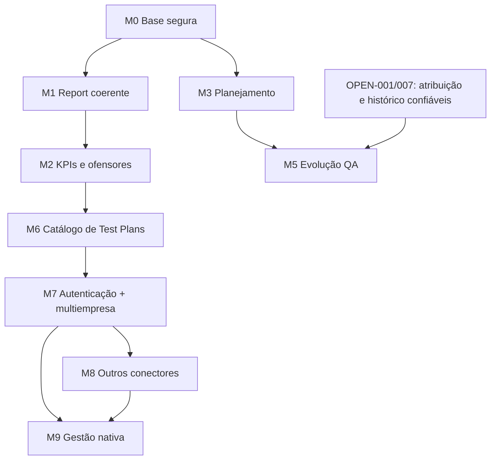

# FourQA — Roadmap do produto e plano de execução

> **20/10/2026 | v1.0 | Planejamento proposto, sujeito à priorização e à capacidade real da equipe.**
> **Para gestão:** este documento explica em qual ordem entregar valor e como saber se uma entrega está pronta. **Para engenharia:** mostra dependências, riscos, gates, testes, evidências e links com histórias do `BACKLOG.md`.

## 1. Objetivo e princípios

O FourQA já funciona como plataforma de acompanhamento ligada ao Azure DevOps. O objetivo agora é transformar essa base em um produto **confiável, configurável por cliente/Test Plan e comercializável**. A maior restrição não é a linguagem de programação: é preservar a verdade dos dados, a segurança de acesso e a operação de planejamento enquanto introduzimos novos recursos.

**O trabalho é entregue em fatias pequenas:** desenhar → validar regra de negócio → implementar → testar → revisar na UI com dados → aprovar → versionar → publicar Preview com autorização. **Um release não é considerado pronto porque o deploy mostrou `Ready`.**

## 2. Situação inicial observada no ZIP

| Área | O que existe na implementação | O que falta para a visão futura |
|---|---|---|
| Report | Tela, KPIs e gráficos; painel de Status reorganizado (4 consolidados + 7 status), Finalizados = Passed + N/A | Rótulos “Impacto do Cliente”, totais, categorias/KPIs gerenciáveis, mapeamentos, revisão de configuração |
| Planejamento | Datas, quantidades, prioridade/QA por suíte, baseline/revisões | Pop-up de total do dia, calendário configurável, distribuição, multi-QA |
| Evolução QA | Não existe visão individual | Metas por QA, comparação automática por status e histórico, solução de atribuição compartilhada |
| Operação | Status por frente, Execuções e Falhas de leitura | Created By, UX/consistência, filtros e auditoria refinados |
| Conectores | Azure REST e sync manual com snapshot | Configuração por plano/cliente, integrações adicionais, telemetria de fontes |
| Segurança | Bearer transitório + proteção Vercel Preview | SSO, papéis, link read-only, isolamento entre empresas |
| Publicação | Preview por CLI; `.vercelignore` presente no ZIP | Checklist de release com alias oficial e smoke, guardar evidência por deploy |

**Não prometer prazo por estimativa não validada.** As fases abaixo são sequenciais por dependência, com paralelismo apenas quando contratos e testes estiverem claros. A data-alvo antiga de uma demonstração não autoriza chamar recursos ainda ausentes de “entregues”.

## 3. Fases e critérios de saída

| Marco | Propósito percebido pelo cliente | Epic(s) | Entrega verificável | Dependência / condição |
|---|---|---|---|---|
| **M0 — Base segura** | Não perder o trabalho e manter a homologação organizada | EP-01, EP-10 | Verificações de deploy, artefatos excluídos, ambientes e docs coerentes | Confirmar Git status, `.vercelignore`, tests, URL oficial; não alterar produção |
| **M1 — Report coerente** | Status confiável e visual apresentável | EP-02 | RPT-003 implementado e validado em dados; nomenclatura e totais corretos (RPT-002/007) | Regressão Report vs Status/Planejamento, cancelados, responsive desktop/mobile |
| **M2 — Report configurável** | Mesmo painel serve a mais de um cliente/plano sem recodificar labels e KPIs | EP-02, EP-03 | Catálogo de métricas, configuração persistida, categorias e mapeamento por Test Plan | OPEN-002/003/004/005; integração com origem real e autorização transitória segura |
| **M3 — Planejamento evoluído** | Gestão diária e alocação automática com responsabilidade | EP-04 | Total do dia, finais de semana, período, distribuição Montanha/Decrescente e compartilhamento numérico | Preservação de baseline/revisões, regras de concorrência, algoritmo e rollback |
| **M4 — Acompanhamento operacional robusto** | Falhas, execuções e frentes explicáveis | EP-06, EP-10 | Created By, filtros e saúde de sync, auditoria de decisões críticas | Modelo de autoria para histórico; suporte a dados ausentes |
| **M5 — Evolução QA individual** | Cada QA enxerga planejado e movimento real, sem digitar nada | EP-05 | Painel por QA e status com dados factuais, séries por dia | **OPEN-001 e OPEN-007 são bloqueadores** para compartilhamento; sem solução, não publicar falsa atribuição |
| **M6 — Experiência por Test Plan** | Entrada com cartões claros por plano conectado | EP-08, EP-07 | Dashboard com 1 card por Test Plan, configurações e conexão manual assistida | Modelo de identidade do plano; gestão de integrações, migração |
| **M7 — Segurança comercial** | Acesso e dados de empresas distintos, seguros | EP-09, EP-10 | Microsoft/Google/SSO, RBAC backend, visualizador externo por link, multi-tenant | ADR de identidade/tenancy e migração, testes cross-tenant, segurança do host |
| **M8 — Ecossistema aberto a conectores** | Projetos além do Azure podem alimentar o FourQA | EP-07 | Adapters Jira/Xray, Zephyr, Octane conforme pilotos autorizados | Portas/catálogo de status normalizado e validação por fornecedor |
| **M9 — Gestão QA própria** | FourQA consegue operar casos e defeitos nativos | EP-11, EP-12 | Gestão de Test Cases, execuções, bugs e associações com rastreabilidade | Produto de acompanhamento estabilizado e autorização completa |

### Sequência aprovada de curta duração (não reordenar implicitamente)

**Etapa 3.1** Status dos Cenários: implementada no ZIP (requer evidência de aceite final do usuário caso ainda não formalizado). Depois: **3.2** Impacto do Cliente + totais → **3.3** KPIs configuráveis → **3.4** ofensores, mapeamento e Infra/Ambiente → **3.5** validação geral de Report. O M0 envolve verificações de segurança transversais, não deve virar desculpa para refazer tudo nem para alterar produção.

## 4. Mapeamento Epic → marcos

| Epic | Resumo de negócio | Quando entra | Condição de iniciar |
|---|---|---|---|
| EP-01 | Qualidade, builds, segurança da publicação | M0 e transversal | Repositório/scope verificado |
| EP-02 | Report executivo e motor de KPIs | M1–M2 | RPT-001/002/003/007/009 e definição de fórmula |
| EP-03 | Impactos e ofensores configuráveis | M2 | RPT-004/005/006/008, campos disponíveis reais |
| EP-04 | Planejamento e distribuição | M3 | ADR 004, capacidade de preservar histórico, regras de curva |
| EP-05 | Evolução QA individual automática | M5 | Solução de atribuição individual e histórico por dia |
| EP-06 | Status, Execuções, Falhas | M4 | Não misturar unidades/metas |
| EP-07 | Conectores e sincronização | M2/M6/M8 | Contratos normalizados e credenciais protegidas |
| EP-08 | Catálogo e dashboard de Test Plans | M6 | Identidade do plano e escopo de configuração |
| EP-09 | Identidade, permissões e multiempresa | M7 | ADR de tenancy/autenticação aprovado |
| EP-10 | Auditoria e operações do produto | M0/M4/M7 | Identidade do ator e política de retenção |
| EP-11 | Gestão nativa de casos | M9 | Critérios de negócio e papéis concluídos |
| EP-12 | Gestão nativa de bugs | M9 | Modelo de casos/runs e permissão de escrita |

## 5. Dependências de maior risco



**Aviso:** é um mapa lógico, não cronograma com estimativas de duração. `M4` pode evoluir junto com `M3` em tarefas isoladas. **Evolução QA compartilhada é bloqueada pelo dado**, não por falta de UI. Em conflito de prazo, entregar menos com métricas corretas.

## 6. Estrutura sugerida do trabalho (Backlog em qualquer ferramenta)

- **Epic** = resultado amplo de negócio (ex.: “Report configurável”).
- **Feature** = capacidade perceptível pelo usuário (ex.: “criar indicador”).
- **Function** = operação pequena que viabiliza a Feature (ex.: “validar fórmula e fonte”). Não significa nome de função TypeScript ou Azure Function.
- **User Story** = necessidade com critério objetivo de aceite, ligada a uma Function. Dividir uma história se ultrapassar uma entrega testável.
- **Task técnica** = implementação ou teste necessário para realizar a história, criada só ao planejar um sprint.

IDs e critérios em `BACKLOG.md`. Se forem espelhados no Azure Boards ou Jira, manter IDs FourQA como campo/tag estável, independentemente do número gerado pela ferramenta.

## 7. Definição de pronto (DoR/DoD)

**Definition of Ready (antes de programar):** história com dono funcional, comportamento exemplificado, população/denominador do indicador, fonte, permissões, escopo por plano, casos de erro, compatibilidade de legado, impacto em banco/API e critérios de aceite. Se OPEN bloqueador, fazer spike de descoberta, não implementar números fictícios.

**Definition of Done (antes de marcar concluída):** código revisado, testes relevantes aprovados, typecheck/build, erros e vazios cobertos, UX/acessibilidade conferidas no painel real e mobile, ausência de alteração em outro plano, documentação impactada atualizada, evidências anexadas, aceite do responsável pelo produto. Se afetar dados: rollback/migração testada. Se afetar acesso: testes negativos de autorização. Não exigir deploy para concluir a implementação, mas exigir smoke para concluir a **publicação**.

### Matriz mínima de teste por alteração

| Tipo de alteração | Evidência mínima |
|---|---|
| Fórmula de Report | Invariantes de status, plano vazio, legado/cancelados, impacto em GAP/% REAL/STATUS, confronto visual |
| KPI/categoria configurável | Dois planos com configurações distintas; campo ausente; não classificado; alteração de label sem alteração de valor |
| Planejamento | Total preservado, revisão histórica, concorrência, sábado/desabilitado, rollback de redistribuição, zero e arredondamentos |
| Evolução QA | Metrificação individual factual, sem dupla contagem, mudança de responsável, Failed como executado, reexecução/atraso |
| Sync Azure | 429/Retry-After, paginação, metadados de falha, refresh atômico, não misturar snapshots |
| Tenant/permissão | Admin escreve; QA leitor não escreve; link só Report; acesso cruzado negado, inclusive API |
| Visual | Painéis lado a lado 1280/1440px, largura real do painel, mobile 390px, teclado e texto legível |
| Deploy Preview | Lista de arquivos sem segredos, Vercel Ready + API/Report smoke, alias oficial aponta deployment desejado |

**Comandos locais** (PowerShell no projeto; verificar primeiro alterações não commitadas):

```powershell
npm.cmd test
npm.cmd run typecheck
npm.cmd run build
# Os testes reais de PostgreSQL exigem TEST_DATABASE_URL própria;
# sem ela, registrar explicitamente que não foram executados.
```

Homologação geral da migração C# (hospedagem, cutover e banco operacional continuam pendentes):

| Teste | Status |
|---|---|
| `Escrita_sem_planKey_nao_cria_plano_no_postgres` | Aprovado em PostgreSQL isolado local, 2026-10-22 |
| `Dois_plan_keys_isolam_revisao_baseline_e_celula` | Aprovado em PostgreSQL isolado local, 2026-10-22 |
| `Celula_revisao_cabecalho_e_periodo_concorrentes_nao_perdem_gravacao` | Aprovado em PostgreSQL isolado local, 2026-10-22 |
| `Publish_obsoleto_nao_substitui_snapshot` | Aprovado em PostgreSQL isolado local, 2026-10-22 |
| `Publish_concorrente_grava_um_lote_inteiro` | Aprovado em PostgreSQL isolado local, 2026-10-22 |
| `Publish_com_falha_no_meio_preserva_snapshot_meta_e_planejamento` | Aprovado em PostgreSQL isolado local, 2026-10-22 |
| `Publish_completo_substitui_catalogo_e_preserva_periodo` | Aprovado em PostgreSQL isolado local, 2026-10-22 |
| `Api_sobre_postgres_reproduz_golden_do_legado` | Aprovado em PostgreSQL isolado local, 2026-10-22 |

**Node primário (2026-10-27, `DEC-032`):** API Express/Vercel única backend operacional; `backend/dotnet/` removido; homolog .NET cancelada. DEC-031 e HTTP 409 Postgres no Node. Fundação Java em `backend-java/` (health apenas) — sem cutover. Alias oficial permanece Node. Direcionamento futuro: ADR 006. Migração funcional não iniciada. Hospedagem, Entra ID e cutover pendentes.

**Porte Python (2026-10-29, `DEC-033`):** a API operacional passou a ser FastAPI. ADR 006 e `backend-java/` ficaram superseded. Dois crashes do porte (regex em `detect_dimensions` e chaves camelCase lidas no domínio snake_case do planejamento) têm correção pontual no código. Isso não torna o porte seguro. **US-098** (P0) é a próxima fatia: teste de frente no nome da suíte, teste de planejamento com snapshot e alocação, e varredura da fronteira snake_case/camelCase. Sem essa regressão, o próximo desencontro continua aparecendo só na sincronização real, com banner genérico.

Nenhum comando acima publica nem altera banco remotamente. Não rodar testes reais que escrevam em ambientes de desenvolvimento compartilhados sem conexão de teste isolada.

## 8. Procedimento controlado de publicação — apenas sob autorização

1. Conferir diff, tests, segredos, commit e branch; não incluir `.env`, `.env.local`, SQLite, planilhas ou backups.
2. Enviar commit ao GitHub pelo PowerShell **somente após aprovação**. Não fazer commit/push automaticamente via Cursor.
3. Criar deployment de **Preview** no projeto existente `fourqa` somente se aprovado (a Vercel atribui URL técnica nova e imutável a cada build; **não cria outro ambiente compartilhado**).
4. Validar versão técnica e saúde da API. Caso válida, **reatribuir** o alias único `fourqa-homolog-heltonmarques-8008.vercel.app` ao novo deployment.
5. Confirmar que o link oficial mostra a versão correta; só ele é comunicado à chefe/cliente. Não usar `vercel --prod`; não comprar domínio; não substituir URLs de deployment imutáveis por tentativa de alias.
6. Anotar: SHA, URL técnica (para rollback interno), destino do alias, data, testes e quem aprovou; rollback = apontar alias ao deployment anterior já validado, se apropriado.

**Contrato de URL:** https://fourqa-homolog-heltonmarques-8008.vercel.app. Ao contrário do endereço compartilhado, o alias precisa de **reatribuição manual a cada novo Preview**; não prometer atualização automática. Ver DEC-027.

## 9. Gestão semanal/sprints (proposta ajustável)

**Cadência recomendada:** uma pequena Feature por ciclo de aceitação (ou por sprint quando couber). Registrar para cada história: `ID`, status real, requisito/decisão, arquivos afetados, risco, testes, evidência, aprovação. Não definir Story Points sem dados da equipe. Para estimativas, usar faixas de incerteza e medir tempo real de execução/homologação, em vez de inventar velocidade.

Quadro sugerido: `Ideia` → `Discovery` → `Pronta` → `Em desenvolvimento` → `Em validação` → `Aceita` → `Publicada`. Histórias bloqueadas usam campo `Bloqueio`, não “em progresso” indefinidamente. Cada Feature concluída deve possuir regressão automatizada e ao menos uma aceitação de negócio correspondente.

### Primeiras histórias recomendadas para a fila

1. **EP-01 — US-001/US-002**: validar correção da exclusão de arquivos na CLI e documentação de release sem alterar produção.
2. **EP-02 — US-006/US-007**: nomenclatura “Impacto do Cliente” e totais próximos dos cabeçalhos (RPT-002/007).
3. **EP-02 — US-009/US-010**: especificar e implementar catálogo persistido de KPIs por plano, sem lógica de fórmula por texto.
4. **EP-03 — US-014/US-015**: categorias administráveis e mapeamento com dados Azure verificados.
5. **EP-02/03 — US-013/US-017**: testes integrados do Report configurável e divergências de população.

A ordem interna depende de evidências do backlog, não de todos os épicos iniciarem ao mesmo tempo.

## 10. Marco de documentação e próximos artefatos

**Documentação base disponível:** `VISION.md`, `REQUIREMENTS.md` (v1.2: Report, Planejamento, Evolução QA e US-044 a US-097), os quatro documentos deste pacote, `CODEBASE_AUDIT.md`, `RESEARCH_VALIDATION.md`, ADRs 001–004. **Os quatro novos arquivos não encerram os requisitos detalhados de todos os módulos.** O backlog registra o trabalho, mas antes de implementar funcionalidades não especificadas no Report, expandir `REQUIREMENTS.md` por módulo, com aprovação e critérios testáveis. Os caminhos operacionais de ADR e Vercel e o alias de homologação estão alinhados a `.cursor/docs/` e a `https://fourqa-homolog-heltonmarques-8008.vercel.app`.

### Critério para declarar a etapa documental concluída

- Quatro novos Markdown estão presentes em `.cursor/docs/`, sem arquivos concorrentes na raiz.
- Todos os Epics/Features/Functions/Stories previstos estão identificados no `BACKLOG.md`.
- Decisões e bloqueios são visíveis e relacionados às histórias.
- Roadmap e critérios de qualidade foram revisados pelo responsável pelo produto.
- **Cobertura funcional completa** só após expansão e aceite dos requisitos detalhados de Planejamento, Evolução QA, Status/Execuções/Falhas, conectores, identidade, multiempresa e demais epics.
