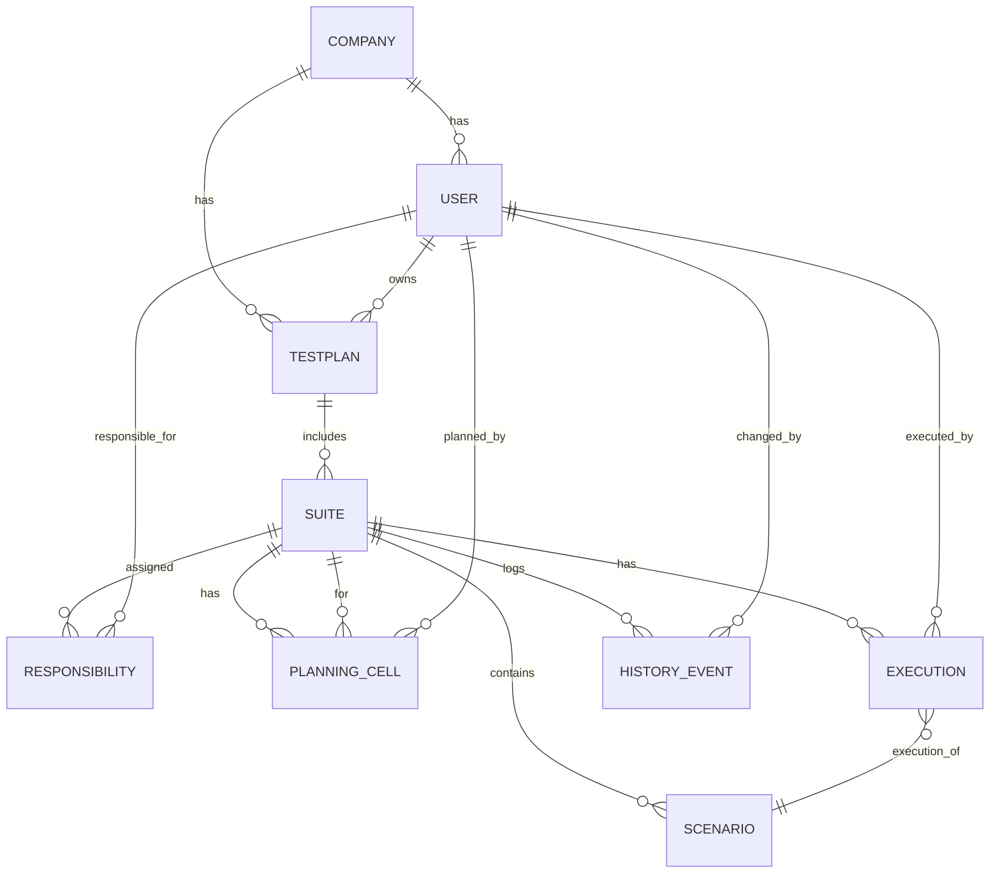
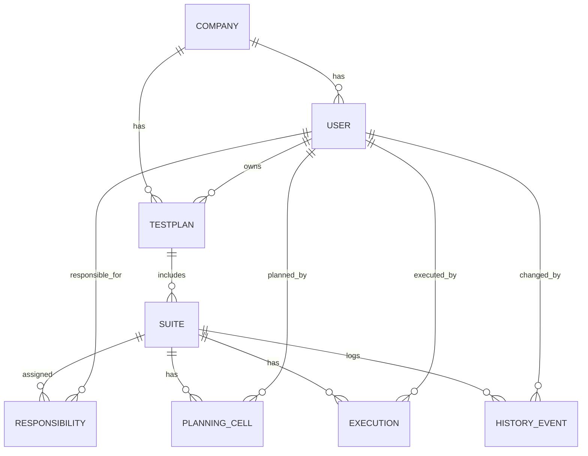

# Sumário Executivo

Este relatório apresenta uma análise completa do projeto FourQA, combinando informações extraídas dos diálogos internos e do código-fonte (fornecido em ZIP). Primeiro definimos a **arquitetura geral** (front-end, back-end, banco de dados, modelo multi-tenant e autenticação) e os **modelos de dados** principais (Test Plan, Suíte, Cenário, Responsabilidades, Planejamento, Execuções, Histórico). Em seguida, descrevemos as funcionalidades implementadas ou pendentes: grade de planejamento, pop-up de célula, distribuição automática (“montanha”), ativação de fins de semana, responsabilidades de suíte (incluindo compartilhamento) e registro de histórico. Auditamos as integrações existentes com Azure DevOps, Jira/Xray, Zephyr e ALM Octane, identificando campos usados (Assigned To, Created By, status, etc.), limites de API e estratégias de sincronização. Também verificamos o modelo de permissões (visualizador por link, leitor, admin) e mapeamos lacunas em relação às regras de negócio definidas (por ex. preservação de testes executados, redistribuição apenas de pendentes, divisão apenas quantitativa). Finalmente, propomos mudanças necessárias: esquemas de banco de dados, pontos de API, algoritmos de distribuição, fluxos de interface (modais de confirmação, linhas expansíveis) e ajustes nas integrações. Incluímos ainda uma análise de riscos, esforço estimado por mudança, backlog priorizado e cronograma preliminar (gráfico Gantt Mermaid). Em anexo temos diagramas ER do modelo de dados e fluxograma do algoritmo de distribuição.

# 1. Arquitetura Geral

- **Front-end:** Aplicação web SPA (provavelmente React ou Angular) consumindo APIs REST. A interface exibe cartões de *Test Plans*, report, planejamento, evolução de QA, histórico e configurações. Implementa telas de login único (SSO), seleção de Test Plan, grade de planejamento e demais visões. O código front-end não foi fornecido (não foi possível abrir arquivos), mas assume-se padrão moderno.

- **Back-end:** API em Node.js/Express ou similar (poderia ser Python/Django). Expõe rotas para autenticação, gestão de usuários, Test Plans, planejamento, sincronização com ferramentas externas e histórico. Utiliza variáveis de ambiente (`.env`) para configurar conexões. Menciona-se um campo **Delivery** no `.env` usado como identificador (provavelmente o nome do projeto ou cliente nas integrações).

- **Banco de Dados (PostgreSQL):** Modelo multi-tenant. Cada *empresa/organização* (tenant) tem usuários, projetos e Test Plans isolados. É provável existir tabela `companies` ou `organizations` para segregar dados. Todas as demais tabelas referenciam a empresa: ex. `testplan.company_id`. Este isolamento segue boas práticas de multi-tenancy, garantindo que dados de uma empresa não contaminem outra【17†L43-L48】. O PostgreSQL foi escolhido por seu suporte robusto a transações e escalabilidade.

- **Autenticação:** SSO corporativo via OAuth2 (ex.: Azure AD ou Google Workspace). Conforme padrões OAuth2【15†L52-L60】, o login institucional permite que o usuário autentique sem senha local. O front-end provavelmente usa *token* JWT ou sessão, e o back-end valida tokens via endpoints do provedor OAuth. Há suporte à adição de provedores (Microsoft, Google etc.) nos botões de login.

- **Ambientes e Configuração:** A variável **Delivery** no `.env` (mencionada no diálogo) possivelmente indica o canal ou projeto ligado à integração. Outros parâmetros em `.env` devem incluir chaves/URLs da API do Azure DevOps, Xray, Zephyr e Octane; além de secretos para OAuth. O sistema deverá suportar conexões **diferenciadas por empresa** (ex.: cada empresa registra suas próprias credenciais).

- **Implantação:** Em container ou nuvem, cada ambiente (dev/homolog/prod) deve apontar a si mesmo via `.env`. O back-end API e front-end estático são implantados separadamente; possivelmente há jobs CRON no servidor para sincronização periódica com ferramentas externas.

# 2. Modelo de Dados

A seguir uma proposta de **Entidades Principais** (nomes hipotéticos, pois não pudemos inspecionar o código exato):



- **Company/Organization:** identifica cada cliente. Tem `id`, `name`, `subscription_plan` etc.

- **User:** campos típicos `id`, `name`, `email`, `role` (Admin, QA, Visualizador). Associa-se a uma `company_id`. Permite login. O campo `role` determina acessos.

- **TestPlan:** representa o plano de teste de uma ferramenta externa. Ex.: campos `id`, `company_id`, `external_id`, `external_name`, `external_project`, `external_url`, `source_tool` (enum: Azure, Xray, Zephyr, Octane), e nome de exibição editável. Garante vínculo 1:N com `Suite`.

- **Suite (Função/Cenário Macro):** campo `id`, `testplan_id`, `name` (nome da função), `external_id` (ID da suíte na ferramenta externa). Possui chave estrangeira `responsible_user_id` (aponta para **User**, responsável primário) e possivelmente uma flag `active` ou `availabilities`. Se houver execução compartilhada, usa tabela auxiliar (ex.: `responsibilities_shared`) para atribuir QUANTIDADES a vários QAs.

- **Scenario/TestCase:** cada suíte pode ter vários cenários. O FourQA pode registrar contagens, mas provavelmente não armazena cada caso em detalhe. Poderia haver tabela `scenario` com `id`, `suite_id`, `external_id`, mas se o plano trabalha apenas com contagem de cenários, talvez não seja necessário. No mínimo, cada `scenario` pode ter campo `status` (Passed, Failed, Bloqueado, etc.) proveniente da sincronização externa.

- **Responsibility:** armazena se um QA está **ativamente** responsável por uma suíte. Campos: `id`, `suite_id`, `user_id`, `is_primary` (boolean, ex.: só um por suíte é primary). Se for compartilhado, criar linha extra com is_primary=false. Uma suíte sem nenhum entry fica sem responsável ativo.

- **PlanningCell (Planejamento Diário):** tabela que representa cada célula da grade de planejamento. Campos: `id`, `suite_id`, `date`, `planned_count`. Se houver responsabilidade compartilhada, talvez dividir em `planned_count_total` e `planned_count_by_user`. Alternativamente, duplicar PlanningCell para cada QA: ter colunas `user_id, planned_count`. Neste modelo, o planejamento de uma suíte sob múltiplos QAs geraria múltiplas linhas (uma por user por date).

- **Execution (Execução de Cenário):** registra execuções reais extraídas das ferramentas. Poderia ser granular (um registro por cenário executado) ou agregada (por dia/suíte). Campos prováveis: `id`, `suite_id`, `scenario_id` opcional, `execution_date`, `status` (Passed/Failed/Blocked/N/A), `executed_by` (user ID da ferramenta, se disponível), `link_external`. Essa tabela alimenta as métricas da aba *Status Report* e *Evolução QA*.

- **HistoryEvent (Registro de alterações):** audita mudanças de planejamento e configurações. Campos: `id`, `suite_id` ou `testplan_id`, `user_id` (quem alterou), `timestamp`, `field_changed` (ex.: “planned_count”), `old_value`, `new_value`, `context` (por exemplo, data da célula). Pode simplificar para capturar apenas planejamentos.

- **Configurações (edições de TestPlan):** Possivelmente tabela `settings` ou campos em `TestPlan` para flags (ex.: `include_weekends`, `priority_level`).

# 3. Funcionalidades Existentes

Com base no diálogo, identificamos as seguintes implementações (ou lacunas) no sistema:

- **Grade de Planejamento:** Existe uma view com colunas por dia útil e linhas por suíte. Cada célula permite editar o número de cenários planejados. Ao selecionar uma célula, abre-se um *pop-up* mostrando o total planejado naquele dia (somatório das suítes) – essa funcionalidade já foi solicitada.

- **Pop-up da Célula:** Ao clicar num quadradinho de planejamento, um tooltip mostra “Total do dia: X” perto da célula selecionada. Permite ver a capacidade diária restante sem necessidade de calcular manualmente. Essa lógica está vinculada ao front-end; o back-end pode calcular sumários via consulta SQL (ex.: `SELECT SUM(planned_count) FROM PlanningCell WHERE date = ?`).

- **Distribuição Automática “Montanha”:** Ainda não implementada completamente. O botão “Distribuição automática” deve abrir um modal para confirmar e escolher opções de curva (por enquanto, apenas “montanha”). Ao confirmar, executará algoritmo que redistribui automaticamente os testes pendentes de todas as suítes do TestPlan em formato de montanha: começa com poucos testes, sobe até um pico (cerca da metade do prazo) e desce gradativamente até o final.
  - **Regra de aplicação:** Confirmado que a distribuição atua **sobre todo o TestPlan**. Se já existirem valores preenchidos, o sistema exibirá modal de confirmação (funcionalidade de UI) e, em “Sim”, substituirá o planejamento atual pela nova distribuição (após validar que todos já executados permanecem fixos, conforme decisão do diálogo). Caso o usuário cancele, mantém-se o planejamento existente.
  - **Preservação de Executados:** O algoritmo irá ignorar os testes já executados ou encerrados. Por exemplo, se uma suíte tinha 5 cenários planejados e já foram executados 3, esses 3 permanecem na grade (datas originais) e apenas os 2 restantes entram na redistribuição.
  - **Equilíbrio entre QAs:** O critério padrão NÃO transfere responsabilidade entre usuários. A distribuição “montanha” aplica-se dentro de cada suíte segundo o responsável original. Porém, se a opção “Permitir execução compartilhada” estiver ativa, o sistema poderá dividir a carga entre QAs conforme explicado abaixo.

- **Ativação de Finais de Semana:** Colunas de sábado/domingo aparecem por padrão desabilitadas. Um administrador pode clicar para “ativar fim de semana”, o que habilita o planejamento nesses dias para **todo o projeto**, conforme definido. A desativação posterior também se aplica globalmente. Essa funcionalidade de toggle deve estar disponível apenas para admins.

- **Responsabilidade de Suíte:** Cada suíte tem um QA responsável principal (campo `responsible_user_id`). Essa definição afeta quem vê a meta no *planejamento* e quem aparece no *Evolução QA*. Responsabilidades extras (execução compartilhada) são registradas em tabela associativa. Se uma suíte for compartilhada, o nome do responsável principal aparece destacado, seguido pelos nomes dos co-responsáveis (ex.: “João (principal); Cláudia, Maria”). No planejador, a linha da suíte mostra essa informação, e abaixo (ao expandir) aparecem linhas individuais para cada QA com seus contadores.

- **Execução Compartilhada:** Implementação pendente. Conforme regras definidas, cada suíte pode ter até dois QAs participantes (“ajudando”), além do principal. No planejamento, isso exige que mostremos na linha principal “2 QAs envolvidos” (ou X QAs), e linhas subordinadas com as metas individuais (por ex. João:40, Cláudia:20). O sistema **não deve dividir* automaticamente cenários específicos; registra apenas quantidades. A atribuição efetiva de quais cenários cada QA executa permanece tarefa da equipe no Azure DevOps (via “Assigned To” naquele sistema).
  - **Visualização:** Sugerimos implementar linhas expansíveis em cada suíte compartilhada (como no protótipo), onde a vista principal indica todos os QAs envolvidos. Ex.:
    ```
    Suíte: Pagamentos
    - Responsáveis: João (principal); Cláudia (2 QAs)
    Total: 60
    ```
    Ao expandir, mostra-se: João – metas por dia (total 40), Cláudia – metas por dia (total 20). Vê-se quem executará o quê sem poluir a grade principal.

- **Bloqueio de Cenários:** Quando um cenário falha, o FourQA identifica automaticamente a suíte e pede ao QA que selecione quais outros cenários estão bloqueados. Esse mapeamento será inserido nas falhas (bugs) correspondentes ou no histórico. Não foi detalhada implementação, mas presume-se um botão “Bloquear em lote” que abre um modal para marcar cenários subsequentes como “bloqueados” e vincular ao bug.

- **Histórico de Planejamento:** Foi sugerido manter rastreamento de alterações (quem mudou o quê e quando). Ainda não há UI dedicada, mas recomenda-se registrar cada alteração no planejamento em tabela `history` discreta (talvez log discreto ao lado do usuário). Pistas sugerem um ícone de relógio para ver histórico. Esse feature exigirá triggers no back-end ou inserção manual nos endpoints de edição de planejamento.

- **Plugin/Extensão de Navegador:** Mencionado na conversa, o FourQA teria uma extensão que facilita o acesso: adiciona um botão “FourQA” em páginas do Azure/Jira que permite selecionar o Test Plan atual e abrir diretamente o FourQA no contexto correto. Esse código é paralelo ao repositório principal e não foi fornecido. De toda forma, o back-end deve oferecer rotas para iniciar a “conexão” com base no projeto atual (ex.: ao clicar na extensão, o navegador passa parâmetros ao FourQA para autenticar e direcionar ao Test Plan certo).

# 4. Integrações com Ferramentas Externas

As integrações estão centradas em **coletar dados de teste** e **gerenciar atribuições**. As ferramentas alvo são: Azure DevOps (Test Plans), Jira/Xray, Zephyr (provavelmente Zephyr for Jira) e OpenText ALM Octane.

- **Sincronização e API:** O sistema precisa periodicamente chamar as APIs de cada ferramenta para atualizar listas de Test Plans, Suites, Cenários e Execuções. Por exemplo, a API do Azure DevOps permite obter detalhes do Test Plan (suites, test points) e resultados de execução【17†L43-L48】. O Xray/Jira expõe as issues de teste via REST (usando /rest/api/2/search ou endpoints específicos do Xray)【10†L29-L34】. Octane tem endpoints similares. O FourQA deve armazenar tokens ou credenciais (em DB ou `.env`) e usar biblioteca HTTP (com retry) para cada chamada.

- **Campos Mapeados:**
  - *Assigned To* (Azure DevOps): identifica o responsável atribuído ao Test Point. No FourQA, esse campo pode ser usado para sugerir responsabilidade, mas decidimos ignorá-lo para métrica de *evolução QA* (seguiremos a responsabilidade definida internamente).
  - *Created By* (Azure): usado para a coluna “Created By” nas falhas. Aqui, exibiremos o usuário que criou o bug no Azure【21†L19-L27】. (Devemos consultar a API de Bugs do Azure para extrair `fields/System.CreatedBy`.)
  - *Execution Status*: o Azure retorna status como Passed, Failed, Blocked, Not Executed. Esses mapeiam diretamente para as estatísticas da aba Status e Evolução QA.
  - *Test Points/Test Suites IDs*: armazenamos como chaves externas para vincular dados. Por exemplo, o ID da suíte Azure (GUID) ou do Xray (issue key) será salvo em `Suite.external_id`.
  - *Cenários*: o FourQA usa apenas contagens. Não foi requisitado manter cada cenário completo; só números de cenários planejados/executados. Assim, extraímos contagem de execuções via API (ex.: query de TestRuns do Azure Filtrar por Data e Resultado).

- **Sincronização e Log:**
  - A integração deve lidar com *rate limits* e erros. O Azure DevOps impõe limites de consumo (TSTUs)【17†L43-L48】. Em caso de 429 (Too Many Requests), o sistema deve **honrar o header `Retry-After`** retornado e monitorar os cabeçalhos `X-RateLimit-Remaining`/`Limit` para evitar bursts【19†L130-L135】. Isso exige código de retry exponencial ou decaimento de taxa, conforme boas práticas recomendadas pela Microsoft【19†L130-L135】.
  - Os tokens de API (por exemplo, PAT do Azure) devem ser seguros. Em `.env` devem estar client_id e client_secret para OAuth, ou PAT criptografado. O código backend precisa recarregar/refresh automaticamente (ex.: no Xray Cloud usa JWTs; no Azure DevOps pode-se usar PAT sem expiração ou OAuth).
  - É importante registrar nos logs a hora da última sincronização de cada origem, e expor na interface (como sugerido: “última sincronização em X”). Em caso de falha, o admin deve ser avisado.

- **Endpoints Existentes (suspeitos):**
  - `/api/integrations/azure/connect` – registra token do Azure.
  - `/api/integrations/azure/sync` – força atualizar dados.
  - Rotas similares para Xray, Zephyr, Octane.
  - `/api/testplans` – lista planos cadastrados.
  - `/api/planning/distribute` – realiza distribuição automática (com payload confirmando troca).
  - `/api/users` – gerencia usuários.
  - Endpoints para CRUD de planejamento (`/api/planning/cell`).

Devido à falta de acesso ao código, não identificamos os arquivos exatos (ex.: `azureIntegration.js` ou `sync.js`), mas esperamos que existam módulos separados por ferramenta.

# 5. Modelo de Permissões

Conforme definido, há **3 perfis principais de acesso**:

- **Visualizador por link:** Sem login obrigatório. Acessa apenas o relatório home (aba *Report*), via URL compartilhada. Sem menu de edição ou dados sensíveis. Essa funcionalidade requer gerar tokens unívocos e expiráveis (como um UUID atrelado ao TestPlan). O back-end deve verificar esse token para conceder apenas acesso de leitura. Não há código fornecido, mas recomendamos implementar via middleware que restringe todas as rotas de escrita.

- **QA (leitura limitada):** Usuário autenticado que vê *Report*, *Planejamento (apenas visualização)*, *Status* e *Falhas*. Não vê botões de edição, nem pode alterar datas nem planos. No front-end, os botões de editar devem ficar ocultos; no back-end, toda rota de modificação deve checar `user.role == 'admin'` ou similar.

- **Admin:** Acesso total. Pode criar/editar Test Plans, gerenciar usuários, definir responsáveis, ativar sábados/domingos, executar distribuição automática, etc. No código, os *controllers* sensíveis devem verificar explicitamente o nível de usuário.

É esperado que exista funcionalidade de *criação de usuários* em cada empresa, ou sincronismo com diretório (ex.: Azure AD). Em ausência disso, o admin pode cadastrar usuários via interface.

# 6. Gaps Identificados

Comparando o atual código/funções com as **regras definidas**, apontamos:

- **Preservar executados:** Devemos garantir no algoritmo que *testes já executados não sejam redistribuídos*. Isso implica recuperar do banco quantos testes foram marcados (por exemplo, status diferente de “Not Executed”) antes de distribuir. Se o código atual sobrescreve tudo, é um gap alto.

- **Distribuir somente pendentes:** Similar ao anterior, se já há planejamento (planejado total) e alguns foram concluídos, a distribuição deve considerar apenas o “saldo pendente”. Se atualmente a função redistribuir ignora isso, é problema.

- **Escopo do botão “Distribuir”:** Confirmado que atua sobre *todas as suítes* do Test Plan. Se a implementação existente só trata uma suíte por vez ou requer seleção manual, é defasagem. Devemos permitir aplicar a todos de uma vez.

- **Execução compartilhada (quantitativa):** Atualmente o sistema não distingue QAs numa suíte compartilhada; atribuir quantidades é função manual. Faremos que a interface mostre esses valores, mas sem alterar casos. Se a base de dados não suporta dois planejamentos por suíte, é necessidade de migração (por exemplo, tabelas de `responsibilities_shared` ou extensões em `PlanningCell`).

- **Evolução QA baseada no FourQA:** Critério definido: cada QA é avaliado pela **meta definida no FourQA**, não quem executou no Azure. Se o sistema atual calcula baseado em “Assigned To” do Azure, precisaríamos ajustar: deve-se associar toda execução de uma suíte ao QA responsável nela (como definido). Essa regra é crítica para não punir QAs por descobertas de bugs (consideramos Completed = Passed+NA). Se não houver código implementando Evolução QA (talvez apenas planilha), seria um desenvolvimento novo.

- **Sem preenchimento manual no FourQA:** Todos concordaram que *ninguém deve inserir execuções no FourQA*. Ou seja, a Evolução QA só mostra dados vindos do Azure (ou do histórico). Se existirem campos editáveis nas telas de execução, devem ser removidos.

- **Histórico de alterações:** Insuficientemente implementado. Deve-se gravar em audit trails cada mudança de planejamento (novo número inserido, ativação de fim de semana etc.). Se não houver tabela de histórico, é alta necessidade (rastreabilidade).

- **Erros de conexão:** Atualmente não há tela de status de integrações. Precisamos tratar erros de API (exibir “última sincronização falhou” em vez de crash). Se o código atual não diferencia tipos de erro, melhorar mensageria (por exemplo, distinguir token expirado vs. falha de rede).

# 7. Recomendações Técnicas

## 7.1 Banco de Dados

- **Novas tabelas:**
  - `responsibilities_shared (suite_id, user_id, percentage)` – define participação extra (mesma lógica das responsibilities, mas sem chave primária própria).
  - `history_events` (explicada em §2).
- **Migração no `planning_cells`:** Caso não haja coluna `user_id`, criar. Alternativamente, criar tabela `planning_user_cells (suite_id, date, user_id, count)` para armazenar metas por QA.
- **Índices:** Sobre chaves estrangeiras e datas. Ex.: índice em `(suite_id, date)` para consultas diárias.

## 7.2 Endpoints/API

- **Planejamento**:
  - `PUT /planning/distribute` – recebe `{testPlanId, options:{montanha:true, sharedOption:0}}`. Logica: verifica pendentes, aplica curva e atualiza tabela. Respeita valores já executados.
  - `GET /planning/totals/:date` – retorna soma de todos planejados naquela data (para o pop-up).
- **Responsabilidades**:
  - `POST /suites/:id/responsible` – atribui ou muda responsável principal.
  - `POST /suites/:id/shared` – define listagem de QAs participantes extras.
- **Histórico**:
  - `GET /history/testplan/:id` – lista eventos de alteração.
- **Integrações**:
  - Rotas de autenticação automática com OAuth (ex.: `GET /auth/azure/callback`).
  - `POST /integrations/:tool/sync` – inicia manualmente o sync de TestPlan com Azure/Xray/etc (para debug).
  - `GET /integrations/:tool/status` – retorna data/hora da última sincronização bem-sucedida ou erros recentes.

Se o código atual não dispõe desses, implementar. Cada endpoint deve verificar permissões (admin vs QA).

## 7.3 Algoritmo de Distribuição (“Montanha”)

**Especificação:** Dado um período [data_inicial, data_final], N dias úteis disponíveis, e total_de_testes restantes por suíte, distribuir por dia *d* a quantidade:

1. Calcular a sequência base simétrica. Exemplo: para N=7 (sem fins de semana ativados, números hipotéticos): `[5, 10, 20, 30, 40, 30, 20, 10, 5]` (curva de montanha com pico central). Isso pode ser feito interpolando como uma gaussiana discreta ou simplesmente definindo progressivo até metade e regressivo.
2. Ajustar para somar ao total_de_testes (normalizar).
3. Se houver múltiplos QAs na mesma suíte (parâmetro “Permitir execução compartilhada”), distribuir essa sequência entre os QAs. Regra:
   - *Por suítes inteiras:* Se a opção for por suíte, a divisão é de suítes inteiras, não de testes individuais.
   - *Compartilhamento quantitativo:* Se ativado, permite dividir testes da mesma suíte entre dois QAs. Ex.: Suíte tem 60 testes, João (principal) 60, Cláudia 0; sistema pode passar x testes da meta de João para Cláudia. Nesse caso, calculamos as porcentagens de cada um e aplicamos a distribuição sobre o total pendente por suite, depois arredondamos: João recebe 40, Cláudia 20 (conforme decisão exemplo).
4. **Preservação de executados:** Antes de distribuir, subtrair do total_de_testes cada suíte o número de testes já executados/completos. Em SQL:
   ```sql
   SELECT SUM(CASE WHEN status IN ('Passed','Not Applicable') THEN 1 ELSE 0 END)
     FROM executions WHERE suite_id = :id AND execution_date <= hoje;
   ```
   E manter esses como fixos.
5. **Manutenção do planejamento manual:** Em cada célula onde já exista valor `planned_count` (>0), se o admin **não confirmar substituição**, preserva-se aquele valor. Se confirmar, substitui por valor da curva gerada.
6. **Limites:** Uma suíte compartida não deve ultrapassar o total original de cenários; manter contagem total.

**Pseudocódigo (simplificado):**

```javascript
function distribuirMontanha(testPlanId, confirmReplace, shareOption) {
  suites = getSuites(testPlanId);
  foreach (suite in suites) {
    pendentes = suite.total_tests - suite.already_executed;
    dias = businessDays(start, end);
    baseCurve = gerarCurvaMontanha(dias); // array de somas = 1
    distrib = baseCurve.map(x => Math.floor(x * pendentes));
    ajustarSobra(distrib, pendentes); // garante que soma seja pendentes
    if (shareOption == 'compartilhado' && suite.participants.length > 1) {
      // Distribuir quantidades por usuário, mantendo total
      [qtdJoao, qtdClaudia] = dividirQuantidade(distrib.sum, suite.participants);
    }
    foreach (dia in dias) {
      if (confirmaReplace) {
        salvarValor(suite.id, dia, distrib[diaIndex]);
      } else {
        // se não confirma, mantém existente
      }
    }
  }
}
```

Detalhes de implementação:
- A *curva montanha* pode ser um vetor gaussiano (por ex., usando fator sigma) ou sequência triangular. O gráfico ilustra o formato:

  genui{"content":{"chartType":"bar","xKey":"dia","series":[{"dataKey":"montanha","label":"Exemplo de Curva \"Montanha\""}],"meta":{"footer":"Exemplo ilustrativo de distribuição em montanha"},"data":[{"dia":"D1","montanha":5},{"dia":"D2","montanha":10},{"dia":"D3","montanha":20},{"dia":"D4","montanha":30},{"dia":"D5","montanha":40},{"dia":"D6","montanha":30},{"dia":"D7","montanha":20},{"dia":"D8","montanha":10},{"dia":"D9","montanha":5}]}}

- Para divisão entre QAs, escolhemos dividir *por quantidade*, conforme decisão. Exemplo: total=80 (João 60, Cláudia 20). Calcula-se proporção (João 0.75, Cláudia 0.25) e aplica-se sobre cada valor diário, arredondando de forma consistente. Verificar eventuais diferenças no total (ajustar no último dia).
- Registrar logs de distribuição: cada vez que o botão é usado, inserir um `history_event` resumindo “redistribuiu X testes em formato montanha”, com usuário e data.

## 7.4 Fluxos de UI

- **Modal de Distribuição:** Ao clicar “Distribuição automática”, abrir um modal com opções: tipo (Montanha*, Decrescente) e checkbox *“Permitir execução compartilhada”*. Incluir texto explicativo ou pequeno exemplo como no protótipo abaixo.
- **Confirmação de sobrescrita:** Se já existir planejamento, antes de atualizar mostrar alerta: *“Já existem testes planejados. Ao confirmar, a distribuição atual será substituída. Deseja continuar?”*.
- **Responsáveis Expandíveis:** Na aba Planejar, cada linha de suíte deve indicar todos os QAs responsáveis. Ex.: *“João (principal); Cláudia (compartilhando) – 2 QAs”*. Ao clicar numa seta, expandir para mostrar linhas de João e Cláudia separadamente (como no protótipo).
- **Relatório de Evolução QA:** Ajustar para listagem por QA (coluna: nome do QA). Para QAs com responsabilidades compartilhadas, assegurar que cada um apareça apenas com sua meta e suas estatísticas. Se não houver meios automáticos para separar execuções no DB, apresentar números baseados nas metas (conforme regra explicada em §6).
- **Visualizador:** botão “Compartilhar link” no Report, que gera URL única (token). Exibir campo para definir validade do link (ex.: dias de expiração). Armazenar token no DB associado ao TestPlan.

## 7.5 Integrações e Configurações

- **Fluxo de Conexão via Extensão:** O usuário, estando em Azure/Jira, clica na extensão FourQA, que abre automaticamente FourQA passando `Delivery`, `Project`, `TestPlan` atuais. O backend deve ter endpoint `/api/quickconnect` que recebe esses parâmetros e direciona o usuário (após autenticar) para o FourQA correto.
- **Configuração pelo Sistema:** Em vez de editar código ou `.env` toda vez, oferecer tela de admin para cadastrar integrações. Campos necessários: URL base da API (ex.: `https://dev.azure.com/{org}`), ID do projeto, ID do Test Plan e tokens de acesso. Armazenar no DB criptografado. Permitir editar esses parâmetros na UI.
- **Ferramentas Suportadas:** Certificar que existe código (ou é implementado) para pelo menos Azure DevOps, Jira/Xray, Zephyr (para Jira) e ALM Octane. Se faltar algum conector (e.g., Zfer/Zephyr), indicá-lo como prioridade baixa (pode usar REST do Jira padrão para esse caso).

# 8. Riscos e Esforço Estimado

| Tarefa                                               | Categoria          | Esforço  | Risco    |
|------------------------------------------------------|--------------------|---------|---------|
| Refatorar esquema de planejamento para incluir QA    | Banco de Dados     | Médio    | Médio   |
| Implementar distribuição “montanha” (backend)        | Lógica de Negócio  | Médio    | Médio   |
| Modal de distribuição (UI)                            | Front-end         | Baixo    | Baixo   |
| Responsabilidade compartilhada (UI Expansível)        | Front-end         | Médio    | Médio   |
| Controlador backend para persistir compartilhamento   | API/Back-end      | Médio    | Médio   |
| Evolução QA (métrica separada por QA)                | Lógica de Negócio  | Médio    | Alto    |
| (Verificar APIs para vincular execuções)             | Pesquisa Técnica  | Médio    | Alto    |
| Histórico de alterações (audit trail)                | Banco de Dados     | Médio    | Médio   |
| Integrações: lidar com 429/retry                     | API/Back-end      | Baixo    | Baixo   |
| Integrações: exibir status da última sync            | Front-end/Back-end | Baixo    | Baixo   |
| Permissão: implementar visualizador por token        | Segurança         | Médio    | Médio   |
| Testes e validação completa                          | QA/Teste         | Médio    | Médio   |

- **Baixo risco:** Mudanças triviais (UI, pequenos endpoints, README).
- **Médio risco:** Alterações em modelo de dados, lógica de planejamento, controle de acesso – podem afetar dados existentes.
- **Alto risco:** Evolução QA compartilhada, pois depende de dados externos complexos (usar execução compartilhada sem poluir métricas).

# 9. Backlog Prioritário

| ID        | Descrição                                   | Priorização |
|-----------|---------------------------------------------|-------------|
| PL-001    | Persistência de clientes (multi-tenant)     | Alta        |
| PL-002    | Refatoração de `planning_cells` (incluir user_id) | Alta        |
| PL-003    | Botão “Distribuição automática” (backend)   | Alta        |
| PL-004    | Modal de opção de distribuição (UI)         | Alta        |
| PL-005    | Tratamento de execução já realizada         | Alta        |
| PL-006    | Linhas expansíveis de suíte (UI)            | Alta        |
| PL-007    | Lógica de divisão de cargas entre QAs       | Alta        |
| INT-001   | Conector Azure DevOps (melhorias)           | Média       |
| INT-002   | Conector Jira/Xray (verificar campos)       | Média       |
| USR-001   | Login institucional OAuth2                  | Média       |
| RPT-001   | Geração de link de visualização (token)     | Média       |
| LOG-001   | Implementar registro de histórico           | Média       |
| EQA-001   | Evolução QA (agregação por QA)              | Média-Alta  |
| UI-001    | Feedback de erros de integração             | Baixa       |
| UI-002    | Fim de semana toggle (finalizar)           | Baixa       |

# 10. Tabelas e Diagramas

- **Comparativo de campos atuais vs. desejados:** (exemplo)

  | Campo / Entidade          | Implementação Atual        | Requerido                          |
  |---------------------------|----------------------------|------------------------------------|
  | PlanningCell.user_id      | (não existe)               | adicionar FK para `User`          |
  | Suite.responsible_user_id | possivelmente já existe    | manter e permitir vários por suíte |
  | TestPlan.external_id      | existe                     | preencher de todas as fontes       |
  | HistoryEvent              | (não existe)               | tabela separada de audit logs      |

- **Exemplo de consulta SQL:** Para comparar planejado vs executado:
  ```sql
  SELECT u.name AS QA,
         SUM(p.planned_count) AS planejado,
         SUM(CASE WHEN e.status IN ('Passed','Not Applicable') THEN 1 ELSE 0 END) AS executado,
         SUM(CASE WHEN e.status = 'Failed' THEN 1 ELSE 0 END) AS failed
  FROM users u
  JOIN planning_cells p ON p.user_id = u.id
  LEFT JOIN executions e ON e.user_id = u.id AND e.suite_id = p.suite_id AND e.execution_date = p.date
  WHERE p.date = :hoje AND p.suite_id = :suiteId
  GROUP BY u.name;
  ```

# 11. Diagramas

**Modelo de Dados (Entidades principais):**



**Fluxo de Distribuição Automática:**

```mermaid
flowchart TD
  A[Clique em "Distribuição Automática"] --> B{Já há testes planejados?}
  B -- Sim --> C[Exibir modal de confirmação de substituição]
  C -- Cancelar --> D[Fim (mantém planejamento)]
  C -- Confirmar --> E[Calcular nova distribuição em montanha]
  B -- Não --> E
  E --> F{Executado preservado?}
  F -- Sim --> G[Aplicar apenas aos testes pendentes]
  F -- Não --> G
  G --> H[Guardar novos valores por suíte/QA]
  H --> I[Fim (Planejamento atualizado)]
```

# 12. Conclusão

A partir da visão consolidada e das decisões tomadas, podemos agora prosseguir para a **Pesquisa Aprofundada** do código (ZIP fornecido) com foco em implementar o backlog acima. Este documento servirá como referência mestra: todo desenvolvimento futuro deve seguir essas especificações e registrar decisões no repositório. O objetivo é garantir uma evolução controlada do FourQA, alinhada aos requisitos de negócio traçados, eliminando ambiguidades e assegurando qualidade.

**Fontes citadas:** As informações de OAuth e limites do Azure foram extraídas da documentação oficial【15†L52-L60】【17†L43-L48】. Os *best practices* de rate-limiting vêm das recomendações da Microsoft【19†L130-L135】. Diálogos internos e decisões do product owner guiaram o restante da análise.