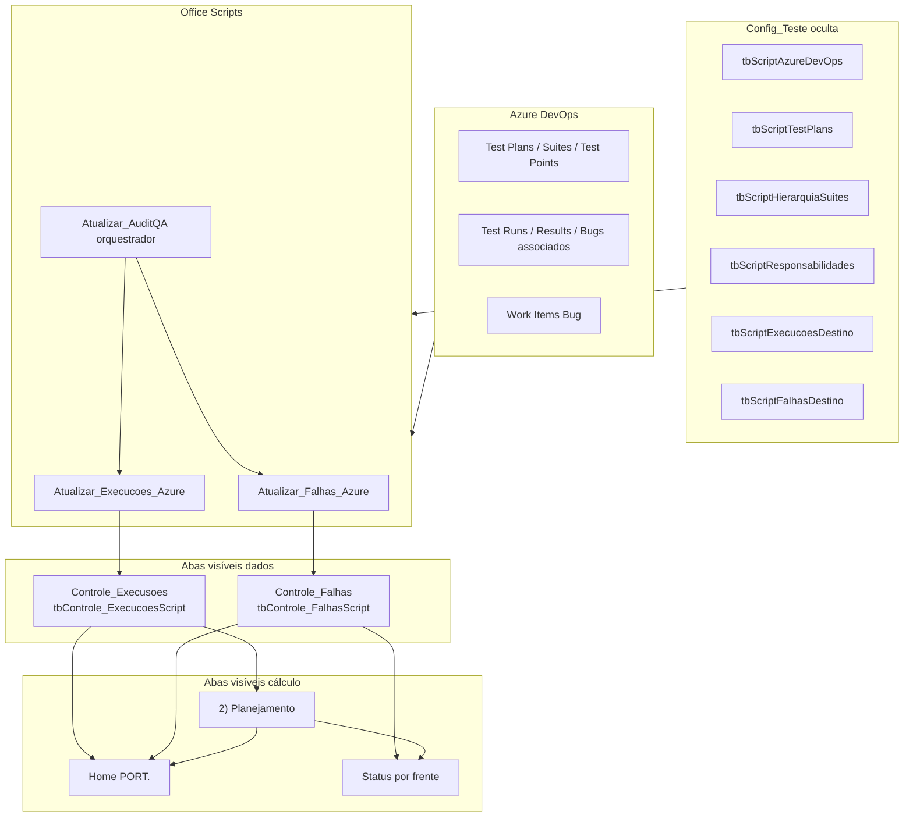

# Entendimento do ecossistema — Status Report QA (Fase 3)

Documento de referência sobre a planilha **Status_Report_Diario_QA_SIAS_EndToEnd_Fase3**, os **Office Scripts** em `fonte/scripts.zip` e como as **fórmulas** consomem as bases de execução e falhas.

**Fontes analisadas**

- Planilha: `fonte/Status_Report_Diario_QA_SIAS_EndToEnd_Fase3 (2).xlsx`
- Scripts: `atualizar_Execucoes_Azure.ts`, `atualizar_Falhas_Azure.ts`, `atualizar_AuditQA.ts`
- Aba de configuração (oculta): `Config_Teste`

**Importante:** credenciais (PAT) ficam em `Config_Teste` / `tbScriptAzureDevOps`. Não devem ser copiadas para código versionado nem para logs.

### Índice — abas em foco (ordem solicitada)

| # | Aba | Seção |
|---|-----|--------|
| 1 | **Home PORT.** | [§6](#6-aba-home-port) |
| 2 | **2) Planejamento** | [§5](#5-aba-2-planejamento) |
| 3 | **Status por frente** | [§7](#7-aba-status-por-frente) |
| 4 | **Controle de Execuções** (`Controle_Execusoes`) | [§3](#3-aba-controle_execusoes) |
| 5 | **Controle de falhas** (`Controle_Falhas`) | [§4](#4-aba-controle_falhas) |

Contexto transversal: [visão geral](#1-visão-geral-do-ecossistema), [Config_Teste](#2-configuração-que-governa-scripts-e-colunas-config_teste), [fluxo operacional](#8-fluxo-operacional-recomendado).

---

## 1. Visão geral do ecossistema

A planilha funciona como um **hub de relatório QA**: scripts alimentam tabelas brutas; abas operacionais aplicam **regras via fórmulas** (principalmente `COUNTIFS` / `SUMIF` sobre tabelas estruturadas).



### 1.1 Papel de cada camada

| Camada | Responsabilidade |
|--------|------------------|
| **Azure DevOps** | Fonte oficial de test points, estados, outcomes, runs, bugs |
| **Config_Teste** | Parâmetros dos scripts (org, projeto, planos, hierarquia, destino das tabelas) |
| **Office Scripts** | Coleta, normalização, gravação nas tabelas Excel; KPIs pontuais na Home |
| **Controle_Execusoes / Controle_Falhas** | Base tabular **sem fórmulas** (dados) |
| **Planejamento / Home / Status por frente** | Agregação, KPIs, visão executiva **com fórmulas** |

### 1.2 Scripts disponíveis

| Script | Função |
|--------|--------|
| `atualizar_Falhas_Azure.ts` | Percorre Test Runs/Results, associa bugs, monta `tbControle_FalhasScript` |
| `atualizar_Execucoes_Azure.ts` | Percorre suítes/test points, monta `tbControle_ExecucoesScript`; calcula KPIs C14:E14 na Home |
| `atualizar_AuditQA.ts` | Orquestra: **1) Falhas → 2) Execuções → 3) auditoria** (usa bases já atualizadas) |

**Ordem recomendada:** Falhas antes de Execuções, porque o KPI da Home (`EX_KPI_*`) lê `tbControle_FalhasScript` para classificar cenários Failed/Blocked.

---

## 2. Configuração que governa scripts e colunas (Config_Teste)

Resumo do que os scripts leem (não substitui a planilha):

### 2.1 Hierarquia de suites (Fase 3 — desta planilha)

| Ordem | Coluna Excel | Nível origem | Ativo |
|-------|--------------|--------------|-------|
| 1 | Frente | 1 | SIM |
| 2 | Processo | 2 | SIM |
| 3 | Nvl 3 | 3 | NÃO |
| 4 | Nvl 4 | ULTIMO | NÃO |

**Regras do script de execuções**

- A **root suite do plano não entra** no caminho (`EX_flattenSuiteTree` começa nos filhos da raiz).
- Só processa caminhos com **profundidade ≥ 2** (`path.length >= 2`).
- **Atalho** não vem da hierarquia: é o texto **antes do primeiro `" - "`** no nome da suite folha (`EX_extractAtalho`).
- **SuiteId / SuiteName** sempre referem a **suite folha** onde estão os test points.

### 2.2 Test Plan ativo nesta cópia Fase 3

| PlanKey | PlanId | PlanName (exemplo na planilha) |
|---------|--------|--------------------------------|
| EndToEnd | 93212 | Validação Transição V1 -> V3 |

Nesta versão analisada, `tbScriptTestPlans` traz **apenas EndToEnd** ativo. Fórmulas das abas focadas usam `PlanKey = "EndToEnd"`. Planilhas de homologação/UAT tendem a repetir a estrutura trocando o PlanKey (ex.: `"UAT"`) — o script de execuções **detecta a fase da Home** pelas fórmulas de `2) Planejamento`, mas **carrega todos os planos ativos** na tabela de execuções.

### 2.3 Destino das bases

| Base | Aba | Tabela | Linha inicial típica |
|------|-----|--------|----------------------|
| Execuções | `Controle_Execusoes` | `tbControle_ExecucoesScript` | 2 |
| Falhas | `Controle_Falhas` | `tbControle_FalhasScript` | 2 |

Scripts exigem `LimparAntes = SIM` e `CriarCabecalho = SIM`. Abas protegidas: senha de proteção **no script** (mesma usada em Falhas/Execuções) — pausa antes de gravar e retoma no `finally`.

---

## 3. Aba `Controle_Execusoes`

### 3.1 Papel

Repositório **bruto** de test points por plano. **Não contém fórmulas** na amostra analisada: toda a inteligência está nos scripts Azure e nas abas consumidoras.

### 3.2 Tabela `tbControle_ExecucoesScript` (cabeçalho linha 2)

| Coluna | Significado |
|--------|-------------|
| PlanKey | Fase lógica (ex.: EndToEnd) |
| PlanId | ID do Test Plan no Azure |
| PlanName | Nome do plano |
| Frente | Nível 1 da hierarquia (ex.: GERORJ) |
| Atalho | Prefixo do menu/processo (ex.: `27`) |
| Processo | Nível 2 da hierarquia (nome do processo/suite) |
| SuiteId / SuiteName | Suite folha Azure |
| TestPointId | ID do test point |
| TestCaseId / TestCaseTitle | Caso de teste |
| Responsabilidade | **Vazio no script atual** (não preenchido por tags) |
| TestCaseState | Estado do work item (ex.: Closed, BUG, QA, Design) — **preservar como TestCaseState** |
| TestPointState | Estado do ponto (Passed, Failed, Blocked, Ready, …) |
| Outcome | Resultado (Passed, Failed, …) |
| DateCompleted / RunBy / LastUpdatedDate | Última execução |
| LastTestRunId / LastResultId | Chaves para KPI e bugs associados |
| TestCaseLink / TestCaseTags | Link e tags |

### 3.3 Como o script popula

1. Lê config em `Config_Teste`.
2. Para **cada plano ativo**, busca árvore de suítes (`testplan/Plans/{id}/suites?asTreeView=true`).
3. Para cada suite folha (concorrência 4), busca test points (`test/Plans/{planId}/Suites/{suiteId}/points` com paginação).
4. Monta registro com hierarquia + propriedades WIT (`System.Title`, `System.State`, `System.Tags`).
5. Consolida planos na mesma tabela (com linha/cabeçalho visual `PLANO: {PlanKey}` entre blocos quando há mais de um plano).
6. Substitui corpo da tabela (resize, limpa linhas/colunas excedentes).

### 3.4 Consumidores principais

- **`2) Planejamento`**: dezenas de `COUNTIFS` por suite (`$D8` = identificador de suite/processo na linha).
- **`Home PORT.`**: totais, impactos, cobertura.
- **KPI script → Home `C14:E14`**: ver seção Home.

---

## 4. Aba `Controle_Falhas`

### 4.1 Papel

Repositório **bruto** de bugs ligados a resultados de teste, com **Impacto** = quantidade de cenários (test points) afetados no plano.

### 4.2 Tabela `tbControle_FalhasScript` (cabeçalho linha 2)

| Coluna | Significado |
|--------|-------------|
| PlanKey / PlanId / PlanName | Origem do Test Plan |
| Responsavel | Derivado de **Categoria** via `tbScriptResponsabilidades` |
| Ambiente | Campo WIT ou inferência (ex.: tag V3Online → V3) |
| Categoria | Campo custom Azure (ex.: Categoria da Falha) |
| ID | Work Item Bug |
| Impacto | **Número de cenários únicos** impactados (não é necessariamente o campo custom “Impacto” do Azure) |
| Frente | Sistemas extraídos das **tags** (GEDEV, GERORJ, …) |
| Título / Status | Work item |
| Criação / Fechamento | Datas formatadas pt-BR |
| Links / Tags | URL e tags |

Frentes válidas no script: `GEATE, GEDEV, GEFEA, GEFIS, GEMCO, GERORJ, GERSA, GESIN`.

### 4.3 Como o script popula

1. Para cada plano ativo: lista **Test Runs** (`test/runs?planId=`).
2. Para cada run (lotes de 5): resultados com `detailsToInclude=WorkItems,Point`.
3. Filtra resultados do plano; opcionalmente filtra por suite (`SuiteNameFilter` / `MaxSuites`).
4. Para cada bug associado ao result, acumula **chave de cenário** (`PLAN:{id}|POINT:{testPointId}` ou fallback suite/TC/config).
5. Busca work items em batch (`wit/workitemsbatch`).
6. Mantém só tipo **Bug**; monta linhas finais e grava em `Controle_Falhas`.

**Não filtra por fase da planilha:** carrega **todos os planos ativos** configurados.

### 4.4 Consumidores principais

- **Home PORT.**: blocos de bugs (abertos/fechados DEV/cliente/reteste).
- **Status por frente**: contagens por frente (`Frente` contém texto parcial).
- **KPI de execuções**: metadados de bug (status/responsável) por ID.

---

## 5. Aba `2) Planejamento`

### 5.1 Papel

Calendário e controle **por suite/processo**: planejado vs realizado, com colunas de outcome agregadas a partir de `tbControle_ExecucoesScript`.

Dimensão típica: dezenas de linhas de suites (ex.: 8–32) e **centenas de colunas** de calendário diário (dias úteis a partir de `D3` / `F3`).

### 5.2 Cabeçalho operacional (linha 7 — recorte)

| Col | Campo |
|-----|--------|
| A | QA |
| B | Prioridades |
| C | Frente |
| D | Processo (identificador usado nos COUNTIFS — ex.: nome/código da suite) |
| E–F | Data início / fim |
| G | REPLANEJAMENTO |
| H–I | QTD CTS PLAN / CTS PLAN DIA |
| K | TOTAL REALIZADO |
| L | CTS Passeds |
| M | CTS N/A |
| N | (cancelados / outros — ver planilha) |
| O | CTS FALHADOS |
| P | CTS BLOQUEADOS |
| Q | CTS LIBERADOS |
| R | CTS DESIGN |
| S | CTS NÃO LIBERADOS |
| … | Colunas W+ = **dias** (fórmulas `TEXT(...,"DDD")`, avanço pulando fim de semana via `MOD(...,7)=6`) |

### 5.3 Padrão central de fórmulas (realizado por suite)

Quase todas as colunas L–S nas linhas de dados seguem:

```excel
=IF($D8="","",COUNTIFS(
  tbControle_ExecucoesScript[PlanKey],"EndToEnd",
  tbControle_ExecucoesScript[SuiteName],$D8,
  ... critérios de TestPointState / TestCaseState / Outcome ...
))
```

**Observações críticas para motor/local API**

1. **PlanKey fixo `"EndToEnd"`** nesta planilha Fase 3.
2. Critérios misturam **TestPointState**, **TestCaseState** e **Outcome** — não são equivalentes.
3. Falhas/bloqueios often exigem `TestCaseState = "BUG"` **ou** segunda condição com `SuiteId` + `Responsabilidade = "Pendências"`.
4. Passed típico: `TestPointState = "Passed"` e `TestCaseState = "Closed"`.
5. N/A: `TestCaseState = "NotApplicable"` e `TestPointState = "Closed"`.
6. Liberados: `TestPointState = "Ready"` e `TestCaseState = "QA"`.
7. Design: `Outcome = "Unspecified"` e `TestCaseState = "Design"`.
8. Não liberados: `TestPointState = "Unspecified"` e `TestCaseState = "Não atribuído"`.

### 5.4 Ligação com Home e Status por frente

- **Home** lê totais da linha **44** (`H44`, `I44`, `J44`, …) e espelha cabeçalhos da linha 7 do Planejamento (`M19` = `'2) Planejamento'!L7`, etc.).
- **Status por frente** agrega Planejamento com `SUMIF` na coluna **C (Frente)** do planejamento, faixa **8:31**, somando colunas H, I, K, O, P, Q, R, S etc.

### 5.5 Detecção de fase (script de execuções)

`EX_detectWorkbookPlanKey` conta ocorrências de `"EndToEnd"` / `"UAT"` (etc.) **dentro de fórmulas** da aba Planejamento. Isso define **somente os KPIs C14:E14**, não o conteúdo da tabela de execuções.

---

## 6. Aba `Home PORT.`

### 6.1 Papel

Dashboard executivo **Fase 3 — EndToEnd** (~106 linhas × 23 colunas). Combina:

- Indicadores de **prazo** (% plan vs real),
- **Bugs** (% DEV, cliente, impactos),
- **Cenários** (totais por outcome),
- Tabela de **suites** (espelho do planejamento),
- Bloco de **bugs detalhado** (contagens sobre falhas).

### 6.2 Blocos principais

| Região | Conteúdo | Origem típica |
|--------|----------|----------------|
| A2 | Título do report | Texto fixo Fase 3 |
| P2/P3, E3/H3 | Período / data / hora | Planejamento + `TODAY()` / `NOW()` |
| C6–F6 | % bugs DEV/cliente/total, replan | `Regras de Calculo` + `SUM(Planejamento!G8:G32)` |
| H6/I6 | % Plan / % Real | `I44/H44`, `J44/H44` |
| Linha 10 | Totais de cenários | Soma linha 44 (planejamento espelhado) |
| Linha 14 | Impactos | **A14** fórmula; **C14:D14:E14** valores escritos pelo script |
| Linha 16 | Cobertura QA | Mapa de Cobertura + contagem falhas |
| Linhas 19–43 | Tabela suites | Referências diretas às linhas 8+ do Planejamento |
| Linha 44 | Totais | `SUM(H20:H43)` etc. |
| ~B79+ | Painel bugs | `COUNTIFS` em `tbControle_FalhasScript` com `PlanKey EndToEnd` |

### 6.3 Impactos — diferença fórmula vs script

**A14 (fórmula Excel — total impactados):**

```excel
COUNTIFS(tbControle_ExecucoesScript[PlanKey],"EndToEnd",
         tbControle_ExecucoesScript[TestPointState],"Failed")
+
COUNTIFS(..., tbControle_ExecucoesScript[TestPointState],"Blocked")
```

**C14:E14 (valores numéricos — script `EX_KPI_writeHomeKpis`):**

- Considera cenários da fase detectada com **`Outcome` Failed ou Blocked** (normalizado).
- Para cada um, busca bugs do **último Run/Result** (`LastTestRunId`, `LastResultId`).
- Classifica usando `tbControle_FalhasScript`:
  - Bug **New/Active** mais recente → Responsável contém **Foursys** → C14
  - Idem → **Cliente/CVP** → D14
  - Sem bug aberto → E14 (Reteste)
- **A14 não é alterada pelo script**; C14+E14+Reteste deve reconciliar com a lógica de negócio desejada (script valida soma interna Foursys+Cliente+Reteste = total Failed/Blocked por outcome).

### 6.4 Funções mais usadas (amostra)

`COUNTIFS`, `SUM`, `IFERROR`, referências a `'2) Planejamento'!…` e `tbControle_*`.

---

## 7. Aba `Status por frente`

### 7.1 Papel

Mini-dashboards **por frente de negócio** (nesta planilha, blocos como **GERORJ** e **GESIN**), repetindo a lógica da Home em escala reduzida: status, cenários, bugs.

### 7.2 Estrutura (padrão por bloco)

Cada bloco usa um rótulo de frente (ex.: **B1 = GERORJ**, **L1 = GESIN**):

| Linha | Conteúdo |
|-------|----------|
| 2–3 | STATUS (ícone), % bugs DEV/CVP, REPLAN, % PLAN/REAL/GAP |
| 6–7 | TTL CTs, PLAN, FINALIZADO, FALHA, BLOQUEADO, LIBERADO, DESIGN, NÃO LIB. |
| 7 | `SUMIF(Planejamento!C8:C31,"*"&B1&"*", Planejamento!H8:H31)` etc. |
| 10–11 | Bugs: total, fechados, abertos DEV, fechados DEV, abertos/fechados cliente, reteste |
| 11 | `COUNTIFS` em `tbControle_FalhasScript` filtrando `PlanKey EndToEnd` e `Frente` contendo `B1` |

**Bloco TOTAL (linhas 15–27):** agrega somando linhas 7–11 de todos os blocos / planejamento (`SUM` de colunas C8:C31 repetidas — fórmulas legadas de consolidação).

### 7.3 Dependências

1. **Planejamento** atualizado (coluna C = Frente para `SUMIF`).
2. **Controle_Falhas** com coluna **Frente** coerente (tags → sistemas).
3. **Controle_Execucoes** indiretamente via Planejamento.

---

## 8. Fluxo operacional recomendado

1. Garantir `Config_Teste` correto (planos, hierarquia, PAT no `.env`/config segura — **não** versionar).
2. Executar **`Atualizar_Falhas_Azure`** (ou passo 1 do Audit).
3. Executar **`Atualizar_Execucoes_Azure`** (atualiza tabela + **C14:E14**).
4. Excel recalcula (`calculate full` já chamado nos scripts).
5. Validar Home / Planejamento / Status por frente.

Para evolução **Motor QA local**: o motor deve reproduzir **colunas e semântica** das tabelas de controle; as fórmulas das abas 5–7 **não precisam mudar** se os nomes de tabela/coluna e valores (TestCaseState, TestPointState, Outcome, PlanKey) forem preservados.

---

## 9. Implicações para um Motor QA (checklist)

| Requisito | Motivo |
|-----------|--------|
| Manter `PlanKey` / `PlanId` / `PlanName` | Fórmulas filtram por `"EndToEnd"` (ou UAT em outras cópias) |
| Preservar **TestCaseState** literal | Regras usam Closed, BUG, QA, Design, NotApplicable, Não atribuído |
| Diferenciar **TestPointState** vs **Outcome** | Planejamento usa ambos; Home A14 usa TestPointState; KPI script usa Outcome |
| Hierarquia Frente / Processo / Atalho | Colunas esperadas na Fase 3 (Processo substitui “Onda” da doc antiga) |
| Falhas: Responsavel + Frente + Impacto | Home e Status por frente dependem desses campos |
| Impacto = contagem de cenários | Script de falhas calcula via runs/results, não só WI field |
| Multi-plano | Tabela de execuções/falhas pode concatenar planos; fórmulas desta cópia ainda filtram EndToEnd |

---

## 10. Lacunas / pontos a validar com negócio

1. **PlanId 93212** nesta Fase 3 vs IDs históricos (86730 / 88145) — scripts leem da planilha, não de constantes.
2. Uso de **SuiteName** vs **SuiteId** vs **Responsabilidade = Pendências** nas contagens de falha/bloqueio no Planejamento.
3. **A14 (TestPointState)** vs **KPI (Outcome)** — alinhamento desejado entre fórmula Excel e classificação por bugs.
4. Coluna **Responsabilidade** vazia no script de execuções vs fórmulas que filtram `"Pendências"`.
5. Tabelas Excel (`tbControle_*`) — openpyxl não listou nomes no modo read-only; na planilha real os `COUNTIFS` referenciam esses nomes (confirmado pelas fórmulas).

---

## 11. Artefatos de apoio gerados na análise

- `fonte/_analysis_fase3.json` — amostra de fórmulas e cabeçalhos extraídos automaticamente.
- `fonte/_analyze_sheets.py` — script reutilizável de extração (opcional).

---

*Documento gerado com base na planilha Fase 3 e scripts em `fonte/scripts_extracted`. Revisar ao trocar PlanId, incluir UAT ou alterar hierarquia em `Config_Teste`.*
